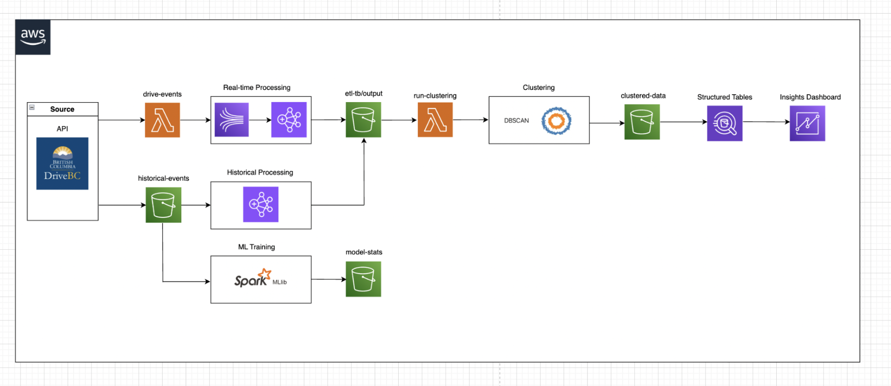
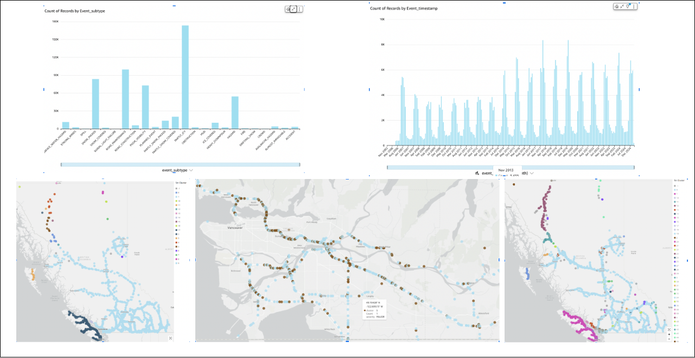

# Real-Time Road Incident Analytics System

A comprehensive data pipeline that processes live road incident data from DriveBC, leveraging Kafka, Spark Streaming, AWS services (S3, Athena, QuickSight, SageMaker, EMR), and Machine Learning to predict incident durations and visualize accident risk patterns.

## Table of Contents

- [Project Overview](#project-overview)
- [Architecture](#architecture)
- [Technologies](#technologies)
- [Project Structure](#project-structure)
- [Data Pipeline Components](#data-pipeline-components)
  - [Data Collection](#data-collection)
  - [ETL Processing](#etl-processing)
  - [Streaming Pipeline](#streaming-pipeline)
  - [Machine Learning](#machine-learning)
  - [Clustering Analysis](#clustering-analysis)
  - [Analytics](#analytics)
- [AWS Infrastructure](#aws-infrastructure)
- [Data Schema](#data-schema)
- [ML Model Performance](#ml-model-performance)
- [Usage](#usage)
- [Configuration](#configuration)

---

## Project Overview

This system ingests real-time road incident data from the DriveBC Open511 API, processes and stores data in AWS S3 in Parquet format, trains ML models to predict incident durations, performs geographical clustering analysis, and visualizes trends through AWS QuickSight dashboards.

### Key Features

- **Real-time data ingestion** from DriveBC API via AWS Lambda and Kinesis
- **Batch processing** for historical archived events
- **Spark Streaming** for continuous ETL on EMR
- **Machine Learning models** for incident duration prediction
- **DBSCAN clustering** for identifying accident hotspots
- **SQL analytics** via AWS Athena
- **Visualization dashboards** in AWS QuickSight

---

## Architecture



### Data Flow

1. **Ingestion**: Lambda function polls DriveBC API and sends events to Kinesis
2. **Streaming ETL**: Spark Streaming on EMR reads from Kinesis, transforms data, writes to S3
3. **Storage**: Cleaned data stored as Parquet files in S3
4. **Analysis**: Athena queries for ad-hoc analysis, clustering algorithms for hotspot detection
5. **ML Training**: Random Forest, GBT, and Neural Network models trained for duration prediction
6. **Visualization**: QuickSight dashboards for trend analysis

---

## Technologies

| Category | Technologies |
|----------|-------------|
| **Data Source** | DriveBC Open511 API |
| **Languages** | Python, SQL |
| **Streaming** | Apache Kafka, AWS Kinesis |
| **Processing** | Apache Spark, PySpark, Pandas |
| **Compute** | AWS EMR, AWS Lambda |
| **Storage** | AWS S3 (Parquet format) |
| **Query Engine** | AWS Athena |
| **Visualization** | AWS QuickSight |
| **ML Frameworks** | Spark MLlib, TensorFlow/Keras, scikit-learn |

---

## Project Structure

```
drive-bc-datapipeline/
├── api_event_collector.py      # Batch collection from DriveBC API
├── lambda-drive-events-function.py  # Lambda for real-time ingestion to Kinesis
├── lambda-run-clustering.py    # Lambda to trigger EMR clustering job
├── etl.py                      # Basic ETL for time-series analysis
├── etl-events.py               # Streaming ETL from Kinesis to S3
├── etl-historical.py           # Batch ETL for historical data
├── etl-ml.py                   # ETL for ML feature preparation
├── cluster.py                  # DBSCAN clustering algorithm
├── ml-sparkml.py               # Random Forest & GBT regression models
├── ml-tensorflow.py            # Neural Network (MLP) model
├── ml-savepipeline.py          # Full ML pipeline with cross-validation
├── inference-prediction.py     # Inference using saved pipeline model
├── simple-analyses.py          # Aggregation analytics by various dimensions
├── athena.sql                  # Athena table creation and sample queries
├── emr-streaming-bootstrap.sh  # EMR bootstrap script for dependencies
├── Data/                       # Sample data files
│   ├── ARCHIVED/               # Archived historical event data
│   ├── historical-cleaned/     # Cleaned historical Parquet files
│   ├── incident.json           # Sample incident JSON
│   └── incidents_data.csv      # CSV export of incidents
├── assets/                     # Pipeline diagrams and visualizations
│   ├── road_incidents_pipeline.drawio.png
│   ├── Coord-1.png             # Coordinate clustering visualization
│   └── Severity-*.png          # Severity clustering visualizations
└── jars/                       # Spark JAR dependencies
```

---

## Data Pipeline Components

### Data Collection

#### Batch Collection (`api_event_collector.py`)

Collects historical and active events from the DriveBC Open511 API:

```bash
python api_event_collector.py [last_offset] [part_num]
```

**Features:**
- Fetches archived events with pagination (500 records per request)
- Handles API rate limiting with exponential backoff
- Skips problematic records causing server errors
- Saves data in JSON format partitioned by threshold (5000 events)
- Collects active events and geographic areas

#### Real-time Ingestion (`lambda-drive-events-function.py`)

AWS Lambda function that:
- Polls the DriveBC API on a schedule
- Sends event data to AWS Kinesis stream
- Uses environment variables for configuration (`DRIVEBC_API_URL`, `KINESIS_STREAM_NAME`)

---

### ETL Processing

#### Basic ETL (`etl.py`)

Transforms raw JSON events for time-series analysis:
- Deduplicates by event ID
- Explodes nested arrays (roads, areas, event_subtypes)
- Converts timestamps
- Outputs: `id`, `event_type`, `event_timestamp`, `severity`, `event_subtype`, `road`, `area`

```bash
spark-submit etl.py <input_path> <output_path>
```

#### Historical ETL (`etl-historical.py`)

Processes historical JSON data with coordinate extraction:
- Handles Point and LineString geography types
- Calculates centroid for LineString coordinates
- Drops unnecessary columns
- Outputs cleaned Parquet files

```bash
spark-submit etl-historical.py <input_json_path> <output_parquet_path>
```

#### ML ETL (`etl-ml.py`)

Prepares data for machine learning with full schema preservation:
- Retains all event attributes for feature engineering
- Processes geographical coordinates
- Maintains nested structures for ML pipeline

---

### Streaming Pipeline

#### Kinesis Streaming ETL (`etl-events.py`)

Spark Streaming job running on EMR:

```bash
spark-submit etl-events.py <kinesis_stream_name> <s3_output_path>
```

**Processing Steps:**
1. Reads from AWS Kinesis stream
2. Parses JSON payloads
3. Explodes nested event arrays
4. Extracts and processes coordinates
5. Writes to S3 in append mode with checkpointing

---

### Machine Learning

The system includes three ML approaches for predicting incident duration (in days):

#### Features Used
- `num_roads`: Number of roads affected
- `num_areas`: Number of areas affected
- `latitude`, `longitude`: Geographic coordinates
- `event_type_index`: Encoded event type
- `severity_index`: Encoded severity level
- `status_index`: Encoded status

#### 1. Spark MLlib Models (`ml-sparkml.py`)

Trains and compares Random Forest and Gradient Boosted Trees:

```bash
spark-submit ml-sparkml.py <parquet_folder_path>
```

**Hyperparameter Tuning:**
- Random Forest: numTrees [50, 100, 150], maxDepth [5, 10, 15], maxBins [16, 32]
- 3-fold cross-validation

#### 2. Neural Network (`ml-tensorflow.py`)

Multi-layer Perceptron using TensorFlow/Keras:

```bash
spark-submit ml-tensorflow.py <parquet_folder_path>
```

**Architecture:**
- Dense(128) → Dropout(0.2) → Dense(64) → Dropout(0.2) → Dense(32) → Dense(1)
- Optimizer: Adam (lr=0.001)
- 100 epochs, batch size 32

#### 3. Full Pipeline (`ml-savepipeline.py`)

End-to-end ML pipeline with model persistence:

```bash
spark-submit ml-savepipeline.py <parquet_path> <model_output_path> <metrics_output_path>
```

#### Inference (`inference-prediction.py`)

Load saved pipeline and make predictions on new data:

```bash
spark-submit inference-prediction.py <input_json> <model_path> <predictions_output_path>
```

---

### Clustering Analysis

#### DBSCAN Clustering (`cluster.py`)

Identifies incident hotspots using density-based clustering:

```bash
spark-submit cluster.py <input_parquet> <coord_output> <severity_output>
```

**Parameters:**
- `EPS_KM = 25`: Cluster radius in kilometers
- `MIN_SAMPLES = 5`: Minimum points for cluster formation
- Uses Haversine distance for geographic coordinates

**Two Clustering Modes:**
1. **Coordinate-based**: Clusters incidents by location only
2. **Severity-weighted**: Incorporates severity scores (MINOR=1, MODERATE=2, MAJOR=3)

#### EMR Trigger (`lambda-run-clustering.py`)

Lambda function to trigger clustering job on EMR cluster.

---

### Analytics

#### Simple Analyses (`simple-analyses.py`)

Generates aggregated statistics grouped by:
- Severity
- Event type
- Road
- Area
- Event subtype
- Time dimensions (year, month, day, hour)

```bash
spark-submit simple-analyses.py <input_parquet> <output_path>
```

#### Athena Queries (`athena.sql`)

SQL queries for AWS Athena:

```sql
-- Create external table pointing to S3
CREATE EXTERNAL TABLE IF NOT EXISTS event (
    id STRING,
    event_type STRING,
    event_timestamp TIMESTAMP,
    severity STRING,
    event_subtype STRING,
    road STRING,
    area STRING
)
STORED AS PARQUET
LOCATION 's3://<bucket-path>'
tblproperties ("parquet.compress"="SNAPPY");

-- Sample aggregations
SELECT COUNT(id), severity FROM event GROUP BY severity;
SELECT COUNT(id), event_subtype FROM event GROUP BY event_subtype;
SELECT COUNT(id), MONTH(event_timestamp), YEAR(event_timestamp) FROM event
GROUP BY MONTH(event_timestamp), YEAR(event_timestamp);
```

#### QuickSight Dashboard

The analytics data is visualized through AWS QuickSight dashboards for trend analysis and incident monitoring:



---

## AWS Infrastructure

### Required AWS Services

| Service | Purpose |
|---------|---------|
| **Lambda** | Real-time API polling, EMR job triggering |
| **Kinesis** | Event streaming |
| **EMR** | Spark cluster for ETL and ML |
| **S3** | Data lake storage (Parquet) |
| **Athena** | SQL query engine |
| **QuickSight** | Visualization dashboards |
| **SageMaker** | ML model training (optional) |

### EMR Bootstrap

The `emr-streaming-bootstrap.sh` script installs required Python packages:

```bash
#!/bin/bash
sudo pip3 install numpy pandas pyarrow scikit-learn s3fs
```

### S3 Bucket Structure

```
s3://etl-tb/
├── output/           # Cleaned event data
├── jars/             # Spark dependencies
│   ├── hadoop-aws-3.3.4.jar
│   └── aws-java-sdk-bundle-1.12.262.jar

s3://clustered-data/
├── cluster.py        # Clustering script
├── coord-clusters/   # Coordinate clustering results
└── severity-clusters/ # Severity-weighted clustering results
```

---

## Data Schema

### Raw Event (from DriveBC API)

| Field | Type | Description |
|-------|------|-------------|
| `id` | String | Unique event identifier |
| `headline` | String | Event headline |
| `status` | String | ACTIVE, ARCHIVED |
| `created` | Timestamp | Event creation time |
| `updated` | Timestamp | Last update time |
| `event_type` | String | Type of event |
| `event_subtypes` | Array[String] | Subtypes |
| `severity` | String | MINOR, MODERATE, MAJOR, UNKNOWN |
| `geography` | Struct | Point or LineString coordinates |

### Cleaned Event (Parquet)

| Field | Type | Description |
|-------|------|-------------|
| `id` | String | Unique identifier |
| `event_type` | String | Event type |
| `event_timestamp` | Timestamp | When event occurred |
| `severity` | String | Severity level |
| `event_subtype` | String | Event subtype |
| `road` | String | Road name |
| `area` | String | Area name |
| `latitude` | Double | Latitude coordinate |
| `longitude` | Double | Longitude coordinate |

---

## ML Model Performance

### Duration Prediction Results

| Model | RMSE | MAE | MSE | R² Score |
|-------|------|-----|-----|----------|
| **Random Forest** | 7.75 | 1.35 | 60.09 | 0.021 |
| **GBT Regressor** | 7.75 | 1.34 | 60.13 | 0.021 |
| **Neural Network (MLP)** | 13.53 | 1.44 | 183.19 | 0.008 |

**Best Model**: Random Forest with cross-validated hyperparameters

> Note: Low R² scores indicate that incident duration is difficult to predict from the available features. Additional features (weather, traffic volume, incident details) could improve predictions.

---

## Usage

### Prerequisites

- Python 3.5+
- Apache Spark 3.0+
- AWS CLI configured with appropriate permissions
- Required Python packages: `numpy`, `pandas`, `requests`, `pyspark`, `scikit-learn`, `tensorflow`

### Running the Pipeline

1. **Collect Historical Data**
   ```bash
   python api_event_collector.py
   ```

2. **Process Historical Data**
   ```bash
   spark-submit etl-historical.py Data/ARCHIVED output/cleaned
   ```

3. **Deploy Streaming Pipeline**
   - Create Kinesis stream
   - Deploy Lambda function with environment variables
   - Start EMR cluster with bootstrap script
   - Submit streaming job:
     ```bash
     spark-submit etl-events.py <stream_name> s3://bucket/output
     ```

4. **Train ML Model**
   ```bash
   spark-submit ml-savepipeline.py output/cleaned s3://bucket/model s3://bucket/metrics
   ```

5. **Run Clustering**
   ```bash
   spark-submit cluster.py output/cleaned output/coord-clusters output/severity-clusters
   ```

6. **Query with Athena**
   - Create table using `athena.sql`
   - Connect QuickSight to Athena for visualization

---

## Configuration

### Environment Variables (Lambda)

| Variable | Description |
|----------|-------------|
| `DRIVEBC_API_URL` | DriveBC API endpoint |
| `KINESIS_STREAM_NAME` | Target Kinesis stream |

### DriveBC API

- Base URL: `https://api.open511.gov.bc.ca`
- Endpoints: `/events`, `/areas`
- Rate Limiting: Handled with exponential backoff
